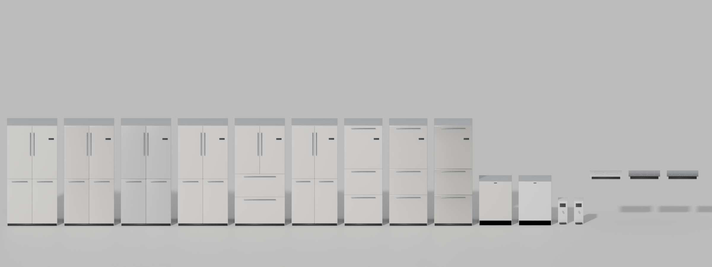
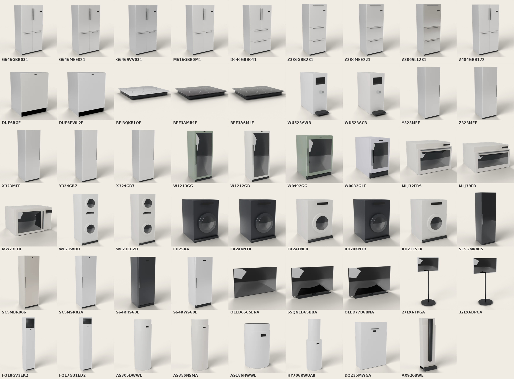

# 제품 도면 (Figma → Blender)

가전·가구 모델은 Figma에서 정면·옆면 도면을 먼저 그리고, 그 도면대로 Blender가 3D를 만든다.

- Figma 파일: [LG 빌트인 제품 도면](https://www.figma.com/design/obpzTCmt78Xh379BQk2LYl) · 페이지 3개(무료 플랜 한도): 냉장고 · 김치냉장고 / 식기세척기 · 인덕션 / 정수기
- 프레임 이름 `<SKU> / 정면`, `<SKU> / 옆면`. 안쪽 `parts` 프레임 = 모델에 쓰는 사각형, `annotations` = 치수선(모델에 안 씀)
- 1px = 1mm. 정면 `parts` 크기 = 카탈로그 폭 × 높이, 옆면 `parts` 폭 = 카탈로그 깊이 (1mm 넘게 다르면 만들지 않음)
- 사각형 이름: `body`, `door/<번호>`, `handle/<문 번호>/<v|h>`, `vent`, `display`, `glass`, `housing`, `spout`, `tray`, `screen`(TV 화면), `window`(오븐·와인셀러·세탁기 유리창).
- 둥근 부품은 사각형에 `shape`를 적는다: `disc` = 정면을 보는 원판(세탁기·건조기 문), `cylinder` = 세로 원기둥(공기청정기·가습기 몸통, 스탠바이미 받침). 지름은 사각형의 짧은 변. 옆면의 `<역할>/side` 가 그 역할의 앞뒤 범위를 정한다 (왼쪽이 앞, `body`는 꼭 있어야 함)
- 윗면 `<SKU> / 윗면`(선택): 위에서 내려다본 모습, 아래쪽이 앞. 원(ellipse)은 상판 위 원 무늬(인덕션 화구·조작부), 사각형은 얇은 인쇄
- 내보낸 값은 `data/drawings/<SKU>.json`. `build_products.py`가 이 파일이 있으면 도면대로, 없으면 종류별 기본 모양으로 만든다 (index.json `layout: "drawing"`)
- 전체 치수만 LGE.COM 값이다. 문 나눔·손잡이 위치는 제품 사진을 보고 그린 화면용 표현이다.

```bash
python services/blender-worker/worker/bpy_scripts/build_products.py \
  --catalog data/catalog/products.json --out apps/web/models/products --sku G646GBB031
```

지금 그린 것: 카탈로그 1,150개 전부.
- 2026-11-19 빌트인 16개 (냉장고 5, 김치냉장고 4, 식기세척기 2, 인덕션 3, 정수기 2): Figma에서 그림
- 2026-11-20 생활가전 37개 (컨버터블 5, 와인셀러 4, 오븐·전자레인지 3, 워시타워 2·워시콤보 1·세탁기 2·건조기 2, 스타일러 3·슈케어 2, TV 3·스탠바이미 2, 에어컨 2, 공기청정기 3·가습기·제습기·청소기): 이날 Figma 무료 플랜 MCP 호출 한도가 다 차서 같은 규칙으로 JSON 도면부터 그렸다. 한도가 풀리면 같은 값으로 Figma 페이지에 옮긴다. 미리 보기: `docs/images/lineup-drawings.png` `tests/unit/test_drawing.py`가 카탈로그 제품마다 도면이 있고 치수가 맞는지 확인한다.

- 2026-11-20 LGE.COM 전체 1,097개: 원래 있던 모델과 종류·크기가 같으면 그 도면을 그대로 쓰고(같은 모델로 묶임), 아니면 종류별 도면 틀(양문형·일반형 냉장고, 뚜껑형 김치냉장고, 통돌이, 미니워시 서랍, 벽걸이 에어컨, 로봇청소기, 유선청소기, 안마의자, 상자형 등)을 그 제품 크기로 그렸다. 문·조작부 위치는 같은 종류 제품 사진을 보고 정한 화면용이다.
- 모양·색이 같은 SKU는 Blender로 한 번만 만들고 파일을 복사한다 (1,097개 → 419벌 렌더).



## 제품 사진

제품 고르기 카드의 사진은 LG 사진이 아니라 위 모델을 Blender Cycles로 렌더한 것 (`apps/web/img/products/<sku>.webp`, 360px, 투명 배경 + 바닥 그림자).

```bash
python services/blender-worker/worker/bpy_scripts/render_thumbs.py \
  --models apps/web/models/products --out apps/web/img/products [--sku W1213GG]
```



## 모델 파일 바꿔 끼우기 (Fusion 등 다른 도구로 만든 모델)

웹은 `apps/web/models/products/index.json`에 적힌 파일을 SKU로 찾는다. 다른 도구로 더 정교하게 만든 모델은 아래만 지키면 파일만 바꿔 끼우면 된다.

- 파일: `apps/web/models/products/<SKU>.glb` (SKU는 카탈로그 그대로, 대문자). 같은 이름으로 덮어쓰면 `index.json`은 손대지 않아도 된다
- 단위 m, Y-up, 바닥 가운데가 원점(바닥 y=0), 정면이 +Z
- 크기 = 카탈로그 폭×높이×깊이 (±3mm). 회전·배율은 메시에 적용해서 노드에 남기지 않는다
- 색을 바꿀 겉판 재질 이름은 `finish` (색 동그라미를 누르면 이 재질 색만 바뀐다). 하나 이상 있어야 한다
- 확인: `uv run pytest tests/integration/test_product_models.py`
- 사진도 새 모델로: `render_thumbs.py --sku <SKU>`로 다시 렌더 (`apps/web/img/products/<SKU>.webp`)
