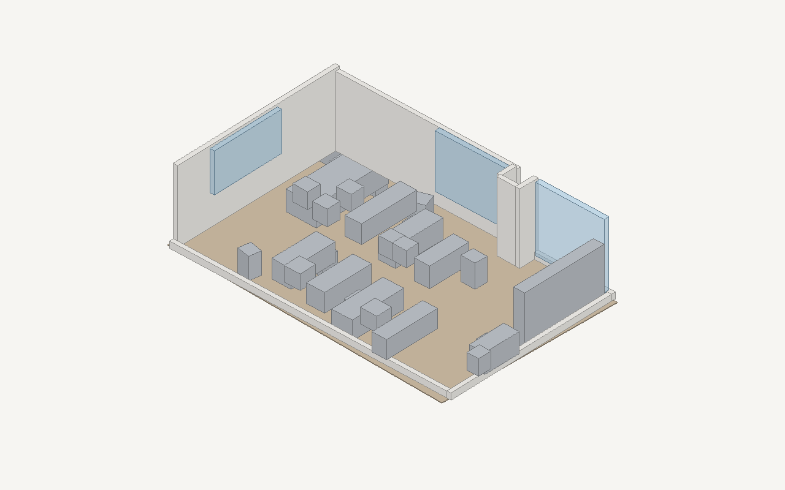

# 실제 UGScan 내보내기 구조 분석 (2026-11-18 스캔)

- 파일: `data/samples/ugscan_2026-11-18.usdz` (UGScan → RoomPlan.usdz, 155 KB)
- 공간: 강의실로 보이는 약 7 m × 10.9 m 방. 책상 10, 의자 18, 수납장 1, 창 4, 문 1.
- 줄자 실측은 아직 없음 → 마진(기획 Q7) 결정은 실측 후.



## 가정과 달랐던 점
| 항목 | 처음 가정 (합성 픽스처) | 실제 파일 |
|---|---|---|
| 루트 | `/Room` | `/RoomPlan` (defaultPrim, Y-up, metersPerUnit 1) |
| 벽 | `Architecture/Walls/Wall0` | `Mesh_grp/Arch_grp/Wall_N_grp/WallN` (Mesh) |
| 문·창 | `Doors/`, `Windows/` 별도 그룹 | **해당 벽의 `Wall_N_grp` 안에 같이 들어 있음** (`Window0`, `Door0`) |
| 바닥 | - | `Floor_grp/Floor0` |
| 가구 | `Object/Storage/Storage0` | `Object_grp/<Category>_grp/<Category>N` |
| 기타 | - | `Section_grp/unidentified0` (방 구역 라벨, 지오메트리 아님) |
| 메타데이터 | - | `*_grp` Xform의 customData `{Category, UUID}` |
| 재질 | - | 요소마다 `<이름>_color` Material (분류 대상 아님, Imageable 아님) |

## 변환기 수정
1. `_grp`로 끝나는 프림은 컨테이너로 본다. 예전 규칙은 `Wall_0_grp`를 벽 하나로 잡고 자손을 건너뛰어서 창·문이 전부 사라졌다.
2. `Section_grp`는 통째로 건너뛴다 (`unidentified0`가 가구로 잡히던 문제).
3. 개구부는 같은 `_grp` 안의 벽에 먼저 붙인다. 없을 때만 가장 가까운 벽.

## 변환 결과
| 벽 | 길이 m | 높이 m | 두께 m | 개구부 |
|---|---|---|---|---|
| w1 | 7.098 | 2.78 | 0.16 | 창 2 (폭 2.86 / 2.85, 창턱 0.47 / 0.46) |
| w2 | 6.720 | 2.78 | 0.16 | |
| w3 | 6.771 | 2.89 | 0.16 | 창 1 (폭 2.82, 창턱 1.07) |
| w4·w5·w6 | 0.89 / 0.65 / 0.76 | | 0.16 | 기둥 주변 꺾인 벽 |
| w7 | 3.037 | 2.78 | 0.16 | 창 1 (폭 2.70, 높이 2.58, 창턱 0.17 — 통창) |
| w8 | 10.867 | 2.78 | 0.16 | 문 1 (폭 0.91, 높이 2.23) |

- 벽 높이가 2.78 / 2.89 두 가지로 나온다. 실제 천장 높이 차이인지 스캔 오차인지 줄자로 확인할 것.
- 두께는 모든 벽이 0.16으로 같다. RoomPlan이 두께를 실측하지 않고 고정값을 주는 것으로 보인다 → 판정에 두께는 쓰지 않는다(현재도 안 씀).

테스트: `tests/unit/test_converter_real.py`, `tests/integration/test_api_flow.py::test_real_ugscan_upload_builds_scene`

## inspect_usdz 출력
```
# data/samples/ugscan_2026-11-18.usdz
upAxis=Y metersPerUnit=1.0 defaultPrim=/RoomPlan

## 프림 트리 (경로 | 타입 | 분류 | 추가 속성)
RoomPlan | Xform | -
  Section_grp | Xform | skip
    unidentified0 | Xform | unidentified
      unidentified0_centerTop | Xform | unidentified
  Mesh_grp | Xform | -
    Arch_grp | Xform | -
      Wall_0_grp | Xform | - | customData={'Category': 'Wall', 'UUID': '6382589C-58D1-4A96-94A0-45B45478606F'}
        Window1 | Mesh | window
        Window1_color | Material | window
          surfaceShader | Shader | -
        Window0 | Mesh | window
        Window0_color | Material | window
          surfaceShader | Shader | -
        Wall0 | Mesh | wall
        Wall0_color | Material | wall
          surfaceShader | Shader | -
      Wall_1_grp | Xform | - | customData={'Category': 'Wall', 'UUID': '378B0EF1-5DF4-4E3E-9043-5D50F0AE1AFD'}
        Wall1 | Mesh | wall
        Wall1_color | Material | wall
          surfaceShader | Shader | -
      Wall_2_grp | Xform | - | customData={'Category': 'Wall', 'UUID': 'C6134449-9962-409D-A8A6-9B7536552F07'}
        Window2 | Mesh | window
        Window2_color | Material | window
          surfaceShader | Shader | -
        Wall2 | Mesh | wall
        Wall2_color | Material | wall
          surfaceShader | Shader | -
      Wall_3_grp | Xform | - | customData={'Category': 'Wall', 'UUID': 'C5326DED-B250-4D62-9E45-12134BC7ACB6'}
        Wall3 | Mesh | wall
        Wall3_color | Material | wall
          surfaceShader | Shader | -
      Wall_4_grp | Xform | - | customData={'Category': 'Wall', 'UUID': '9B3A9037-6511-4762-86EA-657001FF5193'}
        Wall4 | Mesh | wall
        Wall4_color | Material | wall
          surfaceShader | Shader | -
      Wall_5_grp | Xform | - | customData={'Category': 'Wall', 'UUID': '3B28CCF9-7C85-48D7-8B04-9D2C0FFD7219'}
        Wall5 | Mesh | wall
        Wall5_color | Material | wall
          surfaceShader | Shader | -
      Wall_6_grp | Xform | - | customData={'Category': 'Wall', 'UUID': '6CC5FC12-8749-468E-82C3-5AF3ECA39F22'}
        Window3 | Mesh | window
        Window3_color | Material | window
          surfaceShader | Shader | -
        Wall6 | Mesh | wall
        Wall6_color | Material | wall
          surfaceShader | Shader | -
      Wall_7_grp | Xform | - | customData={'Category': 'Wall', 'UUID': '1669571B-F7AB-43F8-B59E-56629283F328'}
        Door0 | Mesh | door
        Door0_color | Material | door
          surfaceShader | Shader | -
        Wall7 | Mesh | wall
        Wall7_color | Material | wall
          surfaceShader | Shader | -
    Floor_grp | Xform | - | customData={'Category': 'Floor', 'UUID': 'AE7F266B-6F1B-469C-92F3-B2FC8781AE73'}
      Floor0 | Mesh | skip
      Floor0_color | Material | skip
        surfaceShader | Shader | -
    Object_grp | Xform | -
      Storage_grp | Xform | - | customData={'Category': 'Storage', 'UUID': '223BA171-F454-443E-B04E-77E6756FC9D2'}
        Storage0 | Mesh | storage
        Storage0_color | Material | storage
          surfaceShader | Shader | -
      Chair_grp | Xform | - | customData={'Category': 'Chair', 'UUID': '625E99CB-D880-4F1C-9AE2-A8C830F6E9B6'}
        Chair17 | Mesh | chair
        Chair17_color | Material | chair
          surfaceShader | Shader | -
        Chair16 | Mesh | chair
        Chair16_color | Material | chair
          surfaceShader | Shader | -
        Chair15 | Mesh | chair
        Chair15_color | Material | chair
          surfaceShader | Shader | -
        Chair14 | Mesh | chair
        Chair14_color | Material | chair
          surfaceShader | Shader | -
        Chair13 | Mesh | chair
        Chair13_color | Material | chair
          surfaceShader | Shader | -
        Chair12 | Mesh | chair
        Chair12_color | Material | chair
          surfaceShader | Shader | -
        Chair11 | Mesh | chair
        Chair11_color | Material | chair
          surfaceShader | Shader | -
        Chair10 | Mesh | chair
        Chair10_color | Material | chair
          surfaceShader | Shader | -
        Chair9 | Mesh | chair
        Chair9_color | Material | chair
          surfaceShader | Shader | -
        Chair8 | Mesh | chair
        Chair8_color | Material | chair
          surfaceShader | Shader | -
        Chair7 | Mesh | chair
        Chair7_color | Material | chair
          surfaceShader | Shader | -
        Chair6 | Mesh | chair
        Chair6_color | Material | chair
          surfaceShader | Shader | -
        Chair5 | Mesh | chair
        Chair5_color | Material | chair
          surfaceShader | Shader | -
        Chair4 | Mesh | chair
        Chair4_color | Material | chair
          surfaceShader | Shader | -
        Chair3 | Mesh | chair
        Chair3_color | Material | chair
          surfaceShader | Shader | -
        Chair2 | Mesh | chair
        Chair2_color | Material | chair
          surfaceShader | Shader | -
        Chair1 | Mesh | chair
        Chair1_color | Material | chair
          surfaceShader | Shader | -
        Chair0 | Mesh | chair
        Chair0_color | Material | chair
          surfaceShader | Shader | -
      Table_grp | Xform | - | customData={'Category': 'Table', 'UUID': '947CC035-AF83-40EA-826E-E1CCF69EEEE5'}
        Table9 | Mesh | table
        Table9_color | Material | table
          surfaceShader | Shader | -
        Table8 | Mesh | table
        Table8_color | Material | table
          surfaceShader | Shader | -
        Table7 | Mesh | table
        Table7_color | Material | table
          surfaceShader | Shader | -
        Table6 | Mesh | table
        Table6_color | Material | table
          surfaceShader | Shader | -
        Table5 | Mesh | table
        Table5_color | Material | table
          surfaceShader | Shader | -
        Table4 | Mesh | table
        Table4_color | Material | table
          surfaceShader | Shader | -
        Table3 | Mesh | table
        Table3_color | Material | table
          surfaceShader | Shader | -
        Table2 | Mesh | table
        Table2_color | Material | table
          surfaceShader | Shader | -
        Table1 | Mesh | table
        Table1_color | Material | table
          surfaceShader | Shader | -
        Table0 | Mesh | table
        Table0_color | Material | table
          surfaceShader | Shader | -

## 변환 결과 요약
w1: len=7.0978 h=2.78 t=0.16 (0.9951, -6.7929)->(1.2237, 0.3012)
w2: len=6.7198 h=2.78 t=0.16 (-5.5046, 4.2093)->(1.2116, 3.9929)
w3: len=6.7707 h=2.8927 t=0.16 (-5.6947, -6.6574)->(1.0725, -6.8755)
w4: len=0.8929 h=2.78 t=0.16 (0.5668, 0.1623)->(0.5956, 1.0547)
w5: len=0.6521 h=2.8927 t=0.16 (0.4894, 0.2448)->(1.1412, 0.2238)
w6: len=0.7611 h=2.78 t=0.16 (0.513, 0.9773)->(1.2738, 0.9528)
w7: len=3.0365 h=2.78 t=0.16 (1.1964, 1.0354)->(1.2942, 4.0703)
w8: len=10.8672 h=2.78 t=0.16 (-5.7773, -6.7348)->(-5.4273, 4.1268)
win1(window) wall=w1 off=3.918 w=2.8649 h=2.1343 sill=0.4741
win2(window) wall=w1 off=0.0774 w=2.8495 h=2.0415 sill=0.4586
win3(window) wall=w3 off=1.5346 w=2.8184 h=1.5449 sill=1.073
win4(window) wall=w7 off=0.0642 w=2.7031 h=2.5816 sill=0.1684
d1(door) wall=w8 off=9.8091 w=0.9072 h=2.2298 sill=0.0
o1(storage) {'w': 3.3248, 'h': 1.9933, 'd': 0.4331} @ (-0.5934, 0.9966, 3.7544)
o2(chair) {'w': 0.5213, 'h': 0.6155, 'd': 0.4625} @ (-3.222, 0.3078, 3.5276)
o3(chair) {'w': 0.6493, 'h': 0.5825, 'd': 0.6132} @ (-3.4762, 0.2913, -2.9505)
o4(chair) {'w': 0.5634, 'h': 0.6073, 'd': 0.5108} @ (-1.5342, 0.3037, -2.0529)
o5(chair) {'w': 0.5894, 'h': 0.8281, 'd': 0.5332} @ (0.1391, 0.4141, -2.5881)
o6(chair) {'w': 0.5664, 'h': 0.9211, 'd': 0.502} @ (-0.8926, 0.4605, 0.6074)
o7(chair) {'w': 0.5817, 'h': 0.6261, 'd': 0.5344} @ (0.3341, 0.313, -4.6438)
o8(chair) {'w': 0.5634, 'h': 0.6073, 'd': 0.5108} @ (-0.5447, 0.3037, -2.0848)
o9(chair) {'w': 0.5634, 'h': 0.6073, 'd': 0.5108} @ (-0.5283, 0.3037, -1.5755)
o10(chair) {'w': 0.6461, 'h': 0.5889, 'd': 0.6159} @ (-4.3454, 0.2945, 0.0966)
o11(chair) {'w': 0.6492, 'h': 0.5825, 'd': 0.6132} @ (-4.3989, 0.2913, -2.9208)
o12(chair) {'w': 0.5634, 'h': 0.6073, 'd': 0.5108} @ (-1.5177, 0.3037, -1.5436)
o13(chair) {'w': 0.5817, 'h': 0.6261, 'd': 0.5344} @ (-0.6735, 0.313, -4.6114)
o14(chair) {'w': 0.5817, 'h': 0.6261, 'd': 0.5344} @ (-1.4616, 0.313, -5.5924)
o15(chair) {'w': 0.5817, 'h': 0.6261, 'd': 0.5344} @ (0.0498, 0.313, -5.6411)
o16(chair) {'w': 0.5213, 'h': 0.6155, 'd': 0.4625} @ (-3.8551, 0.3078, 3.773)
o17(chair) {'w': 0.6461, 'h': 0.5889, 'd': 0.6159} @ (-4.3654, 0.2945, -0.5251)
o18(chair) {'w': 0.5174, 'h': 0.8647, 'd': 0.469} @ (-5.1427, 0.4324, -4.202)
o19(chair) {'w': 0.5817, 'h': 0.6261, 'd': 0.5344} @ (-1.681, 0.313, -4.5789)
o20(table) {'w': 1.8463, 'h': 0.7281, 'd': 0.7642} @ (-3.9469, 0.3641, -3.2257)
o21(table) {'w': 1.6333, 'h': 0.799, 'd': 0.6035} @ (-1.2276, 0.3995, -0.3701)
o22(table) {'w': 2.1118, 'h': 0.7077, 'd': 0.5728} @ (-4.3313, 0.3538, 1.2502)
o23(table) {'w': 1.4376, 'h': 0.7694, 'd': 0.606} @ (-3.2148, 0.3847, 3.7523)
o24(table) {'w': 2.3147, 'h': 0.7257, 'd': 0.6431} @ (-0.7185, 0.3629, -3.325)
o25(table) {'w': 2.1576, 'h': 0.7361, 'd': 0.8158} @ (-4.3554, 0.3681, -0.2142)
o26(table) {'w': 1.945, 'h': 0.735, 'd': 0.7195} @ (-4.0459, 0.3675, -1.6905)
o27(table) {'w': 1.0931, 'h': 0.7826, 'd': 0.6907} @ (0.5876, 0.3913, -6.233)
o28(table) {'w': 1.9799, 'h': 0.7591, 'd': 0.6786} @ (-1.0312, 0.3796, -1.8142)
o29(table) {'w': 3.0242, 'h': 0.7826, 'd': 1.1804} @ (-0.6897, 0.3913, -5.1141)
```
