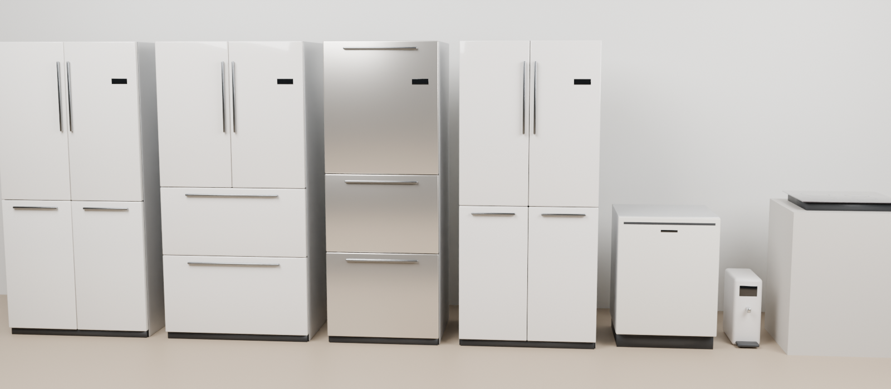

# 웹 화면 스펙

빌드 없는 정적 SPA (`apps/web`). three.js 0.160.0을 `apps/web/vendor/three`에 포함해 인터넷 없이도 뜬다. api(`uv run lgb-api`)가 함께 서빙.

| 경로 | 화면 | 기능 |
|------|------|------|
| `#/` | 내 집 스캔 | 꾸미던 집이 있으면 그 집(`#/c/<pid>`)으로 바로 간다. 없으면 `#/new`와 같다 |
| `#/new` | 새 집 스캔 | USDZ 올리기(셀프 스캔), 도면 함께 첨부(선택), 샘플 집 체험, 최근에 만든 집, 꾸미던 집 "이어서 꾸미기" |
| `#/r` | 방문 스캔 신청 | 신청 폼(목업) → 요청 번호. LiDAR가 없을 때 쓰는 선택 경로 |
| `#/t` | 기사 · 스캔 등록 | 요청 선택, 스캔 주체, USDZ 끌어 놓기, 합성 샘플 등록 |
| `#/t/<pid>` | 기사 · 실측 보정 | 평면도(실측 벽 초록), 3D, 벽 실측 표, 도면, 고객 링크 복사 |
| `#/c/<pid>?t=` | 가상 리모델링 | 아래 "작업대 배치" 참고 |

## 파일 구성
- `app.js` 라우터와 설치 버튼 연결만. 화면은 `js/`에 나눠 둔다.
- `js/core.js` API 호출·라벨·알림, `js/viewer.js` 3D, `js/plan.js` 평면도 SVG, `js/pages.js` 첫 화면·신청·기사 화면, `js/remodel.js` 리모델링 작업대, `js/install.js` 웹앱 설치.
- 빌드 도구 없음. ES 모듈 + import map(three.js).

## 디자인 기준 (2026-11-20 LG 톤으로 바꿈)
- 방향: LG 쇼룸 느낌. 바탕은 LG 공식 Warm Grey(`--warm-grey #f0ece4`), 그 위에 흰 판(반경 20px, 옅은 따뜻한 그림자), 글자 `--ink #1d1c1a`. 상단 바는 반투명 유리 막대.
- 색 출처는 lg.com/global/our-identity/color. Heritage Red(`--lg #a50034`)는 주 버튼과 지금 고른 것에만, Active Red(`--lg-active #fd312e`)는 작은 점 하나 정도로만 쓴다. LG 로고는 쓰지 않는다(글자 "LG HouseTwin"만).
- 판정·시뮬레이션 색은 의미에만: 적합 초록·조건부 호박·불가 빨강, 채광 노랑, 와이파이 파랑, 동선 남색.
- 글꼴 Pretendard 하나(`vendor/fonts`, SIL OFL). 인터넷 없이도 같은 글꼴이 나온다. 한글은 `word-break: keep-all`로 단어 중간에서 안 끊는다. 숫자는 tabular.
- 버튼·세그먼트·칩은 알약 모양. 아이콘은 이모지 대신 선 아이콘(SVG).
- 첫 화면(`#/new`): 전체 화면 렌더 사진 위에 왼쪽 카피, 아래 유리 판(3단계 + 파일 올리기). 사진은 `img/hero-kitchen.webp`(데스크톱), `img/hero-kitchen-m.webp`(휴대폰 세로). 휴대폰은 카피 → 사진 → 단계 순서.
- 첫 화면 렌더: `services/blender-worker/worker/bpy_scripts/render_hero.py`. 카탈로그 치수로 만든 glb(냉장고 G646GBB031, 김치냉장고 Z386GBB281, 식기세척기 DUE6BGE, 정수기 WU523AWB, 인덕션 BEI3QKBLOE)를 붙박이로 넣고 Cycles로 렌더한다. 실행 `python render_hero.py -- out.png 2400 1350 80`(bpy 필요).
- 3D 배경은 톤 매핑 뒤 따뜻한 회색으로 보이게 `#ffe6c4`를 넣는다.
- 평면도 왼쪽 아래에 1 m 축척 막대.

- 고객 화면은 2초마다 `/version`을 확인해 Claude·Codex 대화에서 바뀐 상태(스타일·재질·배치)를 다시 그린다.
- `demo_only` 제품은 "가상 데이터 · 실제 제품 아님" 배지.
- 평면도 좌표는 5cm 단위로 맞춘다. 좌표계는 room.json과 같다(x 오른쪽, y 아래).

## 선택 입력 (도면 · 실측)
- 기본 흐름은 LiDAR 스캔만으로 끝난다. 도면과 실측값은 있으면 넣는 선택 사항.
- 기사 화면: 스캔 등록 때 도면 파일을 함께 첨부할 수 있고, 프로젝트 화면에 벽 실측 표와 도면 칸이 있다.
- 고객 화면: 아래쪽 "도면 · 실측값 넣기"(접힘)에서 도면 첨부, 벽별 실측값 입력 (`by=customer`, 표에 "고객 실측" 표시).

## 작업대 배치 (`#/c/:pid`, 2026-11-20 단순화)
집꾸미기 앱과 빌드 모드 게임의 구성 원리(가운데 큰 3D, 카탈로그 카드, 고른 것만 옆에 자세히)를 참고했다. 제품 목록은 처음에 아래 가로 서랍으로 했다가 지예 의견으로 왼쪽 세로 목록으로 바꿨다. 화면·에셋은 가져오지 않았다.
```
┌ 제목 · 스캔 요약 ──────────────────────────── [3D|평면|나란히] ┐
├ LG 제품 ──┬ [배치|네모 영역|자유 영역] 가구 치우기 둘러보기 조작키 [살아 보기] ┬ 선택 | 놓은 제품 | 마감재 | 추천 | 도면·실측 ┤
│ 검색      │ 3D 집 (크게)                                                  │ 판정, 회전·빼기, 색·재질                     │
│ 카테고리  │                                                               │                                              │
│ 카드 2열  │ 안내 한 줄                                                    ├ 미니맵 [평면 크게]                            ┤
└───────────┴───────────────────────────────────────────────────────────────┴──────────────────────────────────────────────┘
```
- 화면 높이에 맞춘 작업대. 각 칸 안에서만 스크롤.
- 제품은 왼쪽 목록의 사진 카드(2열)로 고른다. 카드 위 타일(`#lib .prod .dot.tile`)과 상세 창 `.pd-photo`에 제품 사진 = 우리 3D 모델을 Blender로 렌더한 것(`img/products/<sku>.webp`, 지금 고른 색의 사진). 사진이 없으면 지금 고른 색·재질을 칠한다. 아래 동그라미로 같은 모델의 다른 색을 고른다. 고른 카드는 LG 레드 테두리.
- 제품 카드를 누르면 3D 위에 **제품 상세 창**(`#pdModal`)이 뜬다. 다나와 같은 가격비교 사이트의 상세 구성(사진, 모델명, 사양 표, 색상 옵션)을 참고했다. 사양 표: 제품 크기, 설치 필요 공간, 여유 공간, 문 열림, 설치 방식, 옵션(종류·도어 수·용량 등 LGE.COM 스펙), 색상·재질, 모델명. 카탈로그에 없는 값은 "확인 안 됨". 설치 사양 근거(spec_notes)는 접어서 보여 준다. **넣어 보기**(`#pdPlace`)를 누르면 창이 닫히고 그 제품을 든 상태가 된다(3D 바닥을 누르면 놓임). 들고 있는 카드를 다시 누르면 내려놓기 취소. Esc로 창 닫기. 카드를 3D로 끌어다 놓는 건 그대로 된다.
- 제품 필터: 종류(칩) + 폭(650 이하 / 650~850 / 850 이상 mm), 높이(900 이하 / 900~1,800 / 1,800 이상 mm), 색상(카탈로그 색 이름). 색상을 고르면 카드도 그 색 SKU로 바뀐다.
- 제품 서랍은 먼저 **"이 공간을 어떤 용도로 쓰실 건가요?"**(주방·거실·침실·세탁실·다용도실·현관·전체 보기)를 묻고, 그 용도에 맞는 가전 종류 칩(카탈로그 `zone_fit` 기준)을 보여 준다. "용도 바꾸기"로 다시 고른다.
- **단계별 옵션 필터**(`#steps`, `js/options.js`의 `optionSteps`): 설치 방식(빌트인/일반) → 종류 → 도어 수 → 용량 → 화면 크기 → 문 여는 방향 → 도어 재질 → 색상 순. LGE.COM·삼성닷컴 상세필터 구성을 참고했다. 앞 단계에서 고른 것으로 좁힌 뒤 남은 제품에서 값이 둘 이상 갈리는 단계만 나오고, 칩에 남은 개수가 붙는다. 값이 많은 숫자(용량 등)는 구간으로 묶는다. 종류를 고르기 전에는 설치 방식만 나온다. "빌트인"에는 빌트인 핏(Fit & Max)이 들어간다. 고른 옵션에 맞는 SKU가 카드의 대표가 되고, 카드 → 넣어 보기로 바로 놓는다.
- 종류 칩 순서는 `CATEGORY_GROUP` 순.
- 목록에는 지금 LGE.COM에서 파는 제품(`sale_status`가 ACTIVE·SOLD_OUT)만 나온다. 비매품과 확인 못 한 제품은 넣을 수 없다. 판매 상태를 화면에 따로 적지는 않는다.
- 조작키는 툴바 "조작키" 버튼으로 여는 창에 모았다(제품·화면·둘러보기). 휴대폰은 키보드가 없어서 버튼을 숨긴다.
- 영역 도구 이름: "네모 영역"(끌어서 사각형), "자유 영역"(꼭짓점을 차례로 눌러 다각형).
- 기본 보기는 3D. 평면은 오른쪽 패널 아래 미니맵. "평면 크게 / 3D 크게"로 바꾸고, "나란히"는 반반.
- 다른 화면에 다녀와도 그대로: 꾸미던 집과 보던 화면(보기, 오른쪽 탭, 살아 보기, 카테고리, 3D 카메라)을 localStorage에 적어 둔다. 놓은 제품·가구·마감재는 서버(SQLite)에 저장된다.
- 렌더 이미지는 3D가 보일 때만 버튼이 나오고, 결과는 작업대 위에 띄운다.
- 제품을 놓거나 무언가 누르면 오른쪽이 "선택" 탭으로, 영역을 그리면 "추천" 탭으로 넘어간다.
- 1280px 미만: 왼쪽 236px·오른쪽 300px, 제품 카드는 한 줄에 하나(작은 사진 + 이름). 900px 미만(휴대폰): 위에서부터 제목 → 3D → 제품(2열) → 탭.
- 휴대폰 390px에서 가로 스크롤 없음.

## 웹앱 설치 (PWA)
- `manifest.webmanifest`, 아이콘(`icons/`), 서비스 워커(`sw.js`).
- 서비스 워커: 화면 파일과 three.js는 네트워크 먼저 받고 캐시에 저장, 끊기면 캐시로. 설치할 때 `models/products/index.json`에 있는 제품 사진도 같이 받아 둔다. `/api/`는 캐시하지 않는다(스캔·판정은 항상 서버 값).
- 서비스 워커는 `localhost` 또는 HTTPS에서만 켜진다. 팀 PC에서 `http://localhost:8000`은 바로 되고, 같은 와이파이의 휴대폰에서 `http://<PC IP>:8000`으로 열면 홈 화면 추가는 되지만 오프라인 캐시는 꺼진다.
- 설치 버튼: 크롬·엣지는 `beforeinstallprompt`가 오면 상단 "앱 설치". 아이폰 Safari는 버튼을 누르면 "공유 → 홈 화면에 추가" 안내.
- `.js`·`.webmanifest` MIME은 api가 직접 지정(Windows에서 `.js`가 text/plain으로 잡히는 문제 방지).

## 리모델링 기능 (2026-11-19)
- 첫 화면 `#/` = 내 집 스캔 올리기 (셀프 스캔 기본, `scanned_by=customer`), 샘플 집 체험. 기사 방문 신청은 `#/r`.
- 왼쪽 제품 서랍: 카테고리 칩, 검색, 치수 없는 제품은 흐리게(놓기 불가), 가상 데이터는 배지.
- 같은 모델은 한 줄: 종류·치수·Figma 도면 모양이 같고 색·재질만 다른 SKU는 묶어서(`/api/catalog/families`) 줄 안의 동그라미로 고른다. 놓은 뒤에도 선택 탭에서 같은 모델 안의 다른 SKU로 바꿀 수 있다(`PATCH … {sku}`, 다른 모델로는 못 바꿈).
- 평면도: 제품을 누르고 평면도 클릭 또는 끌어다 놓기 → 놓기 전 점선 미리 보기(판정 색). 놓은 제품은 끌어서 이동(저장 없이 `pose-check`로 미리 보기, 놓으면 `PATCH`), R 키·버튼으로 15° 회전, Delete로 빼기. 정면 쪽 변은 굵은 선.
- 기존 가구를 누르면 오른쪽에서 치우기/되돌리기.
- 오른쪽 탭: 선택(판정과 이유, 색·재질은 같은 모델의 LGE.COM SKU만), 놓은 제품, 마감재(벽·바닥 색, 채팅에서 저장한 스타일), 추천(영역별), 도면·실측.
- 휴대폰 폭(390px)에서 가로 스크롤 없음.

## 3D에서 바로 배치 (S10)
- 제품을 고르고 3D 바닥 위로 움직이면 반투명 미리 보기 상자(판정 색, 벽 붙이기 반영). 누르면 놓인다. 제품 목록에서 3D로 끌어다 놓아도 된다.
- 놓은 제품을 끌면 바닥을 따라 움직이고(그동안 카메라 회전 멈춤), 바닥 판 색이 판정에 따라 바뀐다. 놓으면 저장.
- 빈 곳을 끌면 시점 회전, 휠·두 손가락으로 확대. 6px 이하로 움직이면 클릭으로 본다.
- 올려 두는 가전(전자레인지·정수기 등)은 손에 들거나 끌 때 커서가 가리키는 식탁·아일랜드·하부장 윗면을 따라 올라가고,
  바닥을 가리키면 내려온다. 높이는 서버를 기다리지 않고 화면에서 바로 맞춘다 (`viewer.js productTops`, 서버 규칙과 같게).
- 스캔 가구를 누르면 오른쪽 "선택"에서 치우기. 공유기·현관·싱크 지정도 3D 바닥을 눌러서 한다.
- 놓은 제품은 glb를 다시 받지 않고 화면에서 상자로 그린다(바닥 판 = 판정 색, 고른 제품 = LG 레드, 앞쪽 아래 검은 띠 = 정면). glb는 벽·바닥 색, 치운 가구, 실측이 바뀔 때만 다시 받는다.
- 살아 보기 결과(볕 드는 자리·하루 직사 시간·와이파이 세기·동선·좁은 곳)는 평면 오버레이 SVG를 그대로 3D 바닥 텍스처로 깐다.
- 영역 그리기(□·⬠)는 평면에서만. 도구를 고르면 평면이 크게 바뀐다.
- 점검: `node tests/e2e/demo_flow.js` (서버를 켠 상태, Playwright 필요).

## 제품 3D 모델 (Blender)



- 놓은 제품은 치수 상자 대신 `apps/web/models/products/<sku>.glb`를 불러와 그린다. 모델이 없거나 못 받으면 예전처럼 치수 상자로 그린다.
- 모델은 `services/blender-worker/worker/bpy_scripts/build_products.py`가 카탈로그에서 만든다. 크기는 `product_dims_mm`(LGE.COM 값) 그대로, 바닥 가운데 원점, 정면 +Z.
- 모양(문 나눔, 손잡이, 화구 무늬, 표시창)은 카테고리별 화면용 표현이다. 실제 제품 도면이 아니다.
  - 냉장고: 4도어(위 양문 + 아래 좌우 서랍), 컨버터블 드로어(위 양문 + 아래 서랍 2단)
  - 김치냉장고: 386L 3도어, 480L 4도어 · 식기세척기: 앞판 + 손잡이 홈 + 걸레받이 · 쿡탑: 유리 상판 + 화구 · 정수기: 표시창 + 출수구 + 물받이
- 재질: 카탈로그 재질 이름으로 느낌을 정한다(글라스 = 광택 코팅, 메탈·스테인리스 = 금속성). 문 앞판 재질 이름은 `finish`, 웹에서 고른 색으로 바꾼다.
- 화면: ACES 톤 매핑, 실내 반사(RoomEnvironment), 해 그림자. 고른 제품과 미리 보기에만 판정 색 테두리를 그리고, 바닥 판은 늘 판정 색.
- Blender 렌더(`build_scene.py`)도 같은 제품·가구 모델을 쓴다. 기본은 Cycles CPU, 빠르게 보려면 `.env`에 `BLENDER_ENGINE=EEVEE`.
- 카탈로그를 바꾸면 모델을 다시 만든다:
  ```bash
  blender -b -P services/blender-worker/worker/bpy_scripts/build_products.py -- \
    --catalog data/catalog/products.json --out apps/web/models/products
  uv run pytest tests/integration/test_product_models.py   # 치수가 카탈로그와 3 mm 안인지
  ```
  Blender 대신 `pip install bpy`(Python 3.13) 모듈로 `python build_products.py --catalog … --out …`도 된다.

## 스캔 가구 3D 모델 · 방 다듬기
- 스캔 가구(RoomPlan 종류: 의자·책상·수납장·소파·침대)는 `apps/web/models/furniture/<종류>.glb`로 그린다. 스캔 상자는 안 보이게 두고 고르기에만 쓴다.
- 모델은 `bpy_scripts/build_furniture.py`(Blender)가 종류별 기준 크기로 만든다. 웹(`js/room3d.js`)이 부품별 `rig`로 스캔 크기에 맞춘다.
  - 축마다 `s` 크기·위치 늘림, `p` 위치만, `e` 크기 그대로 + 가까운 모서리 거리 유지. 그래서 책상이 길어져도 다리 굵기·상판 두께는 그대로다.
  - 모르는 종류는 예전처럼 상자로 둔다.
- 방: 바닥은 마루 무늬(마감재에서 고른 색이 곱해짐), 벽 아래 걸레받이, 창은 유리 + 창틀·창살, 문은 나무 + 문틀.
- 툴바 **가구 모두 치우기 / 가구 N개 되돌리기**: `PUT /api/projects/{pid}/objects/hidden {hidden, object_ids?}` (object_ids가 없으면 전부). 치운 가구는 판정·동선에서도 빠진다.
- 다시 만들기: `blender -b -P services/blender-worker/worker/bpy_scripts/build_furniture.py -- --out apps/web/models/furniture`

## 건축 모드 (집어 들기 · 키보드)
- 3D에서 제품이나 스캔 가구를 누르면 집어 든다: 살짝 떠올라 커서를 따라오고(10 cm 격자, Alt는 1 cm), 제품은 바닥 판이 판정 색으로 바뀐다. 다시 누르거나 Enter로 내려놓으면 저장, Esc는 원래 자리로.
- 키: R / `.` 45° 돌리기, Shift+R / `,` 반대, Alt를 같이 누르면 15°. 방향키 10 cm(Shift 1 cm) 화면 기준으로 옮기기. Delete 지우기(제품은 빼기, 스캔 가구는 치우기). WASD 카메라 이동, Q/E 카메라 돌기.
- 들고 있을 때만 바닥에 0.5 m 격자가 보인다.
- 스캔 가구 자리: `PUT /api/projects/{pid}/objects/{oid}/pose {center_xz, yaw_rad}`, 되돌리기 `DELETE …/pose`. 스캔 파일(room.json)은 그대로 두고 `scene_state.object_poses`에만 적는다. `GET /room`·판정·동선·3D는 옮긴 자리를 쓴다.
- 되돌리기: 툴바 화살표 버튼과 Ctrl+Z(맥 ⌘Z). 놓기·옮기기·돌리기·색 바꾸기·빼기·가구 치우기를 한 단계씩 되돌린다(화면을 연 뒤 한 것만, 최근 30번).
- 설치 전 확인: `GET /api/projects/{pid}/install-check`. 놓은 제품마다 놓을 자리, 문 열고 쓰는 앞 공간, 줄자로 잴 벽, 방 문 통과, 현장에서 볼 것(현관·복도·엘리베이터, 콘센트, 급수·배수)을 한 줄씩 보여 준다. 고객 화면은 "놓은 제품" 탭 아래 접힌 칸, 기사 화면은 맨 위 칸. 스캔으로 알 수 없는 항목은 지어내지 않고 "현장 확인"으로 둔다.
- 방문 설치 신청: "구매 및 설치 신청" 창의 "이대로 방문 설치 상담 신청" → `POST /api/projects/{pid}/install-request {name, contact, address, preferred_at?}`. 놓은 제품과 설치 전 확인 요약이 신청에 같이 저장되고(`kind: "install"`), 기사 화면 첫 페이지 "방문 설치 신청" 목록에서 그 집으로 바로 들어간다. 놓은 제품이 없으면 422. 가격은 카탈로그에 없어서 제품마다 LGE.COM 링크로 보낸다.
- 처음 모습: 3D 오른쪽 위 "처음 모습" 버튼. 스캔 그대로의 장면(`GET /api/projects/{pid}/files/before.glb`, 가구 그대로·마감과 제품 없음)을 같은 시점으로 겹쳐 보여 준다. 다시 누르면 지금 모습. 꾸민 상태는 바뀌지 않는다.
- 예전에 만든 집(3D 파일에 가구 종류가 없음)도 room.json의 종류로 가구 모델을 그린다.

## 1인칭 둘러보기
- 3D 위 '👀 둘러보기'로 켠다. 눈높이 1.6 m, 화면을 누르면 마우스로 둘러보기(Pointer Lock, Esc로 풀림), W A S D·방향키 걷기(1.4 m/s), Shift 빠르게(2.6 m/s). 마우스를 못 잠그는 기기(터치)는 끌어서 둘러본다.
- 충돌: 몸 반지름 0.25 m. 벽(두께 반 + 반지름), 스캔 가구·놓은 제품(회전 상자), 방 외곽 밖은 못 간다. 막히면 벽을 따라 미끄러지고, 한 번에 길게 움직여도 잘게 나눠 벽을 뚫지 않는다 (`js/walk.js`, 테스트 `tests/web/walk.test.mjs`).
- 켜져 있는 동안 집어 들기·배치·건축 키는 꺼지고, 컷어웨이 없이 벽이 다 보이며 천장이 생긴다. 채광을 켜 두면 같은 해 방향·빛으로 보인다.
- 평면만 보기로 바꾸거나 '둘러보기 끝내기'를 누르면 원래 카메라로 돌아간다.
